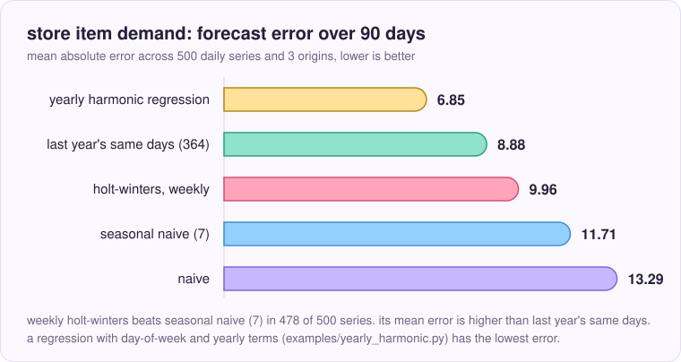
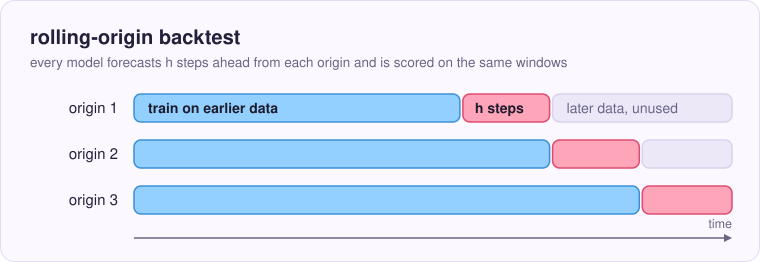

# forecast-backtest

[](https://github.com/collisionattack/forecast-backtest/actions/workflows/test.yml)
[](LICENSE)


a claude skill that makes time-series forecasts prove themselves. claude scores simple baselines first, so a model only counts once it beats them on a rolling-origin backtest.

<picture>
  <source media="(prefers-color-scheme: dark)" srcset="assets/baseline-vs-model-dark.svg">
  
</picture>

on the store item demand data (500 daily series, 90-day horizon) a weekly holt-winters model beats the weekly seasonal naive baseline in 478 of 500 series. add last year's same days as a second baseline and it loses, with a mean absolute error of 9.96 against 8.88. the skill makes claude run both before it says a model works. a regression with a yearly term, `examples/yearly_harmonic.py`, reaches 6.85. the data is the [store item demand forecasting challenge](https://www.kaggle.com/c/demand-forecasting-kernels-only) on kaggle, which has its own rules and is not included here.

## install

clone it into your skills folder:

```bash
git clone https://github.com/collisionattack/forecast-backtest ~/.claude/skills/forecast-backtest
```

you need python 3.10 or newer, pandas 2.0 or newer and numpy. the ets examples also need statsmodels. ci runs the oldest and the newest of these on linux and windows.

## use

ask claude something like "forecast the next 12 months and tell me if it beats a baseline". the skill's description has english and turkish trigger phrases, so "tahmin" works too.

you can also run the script yourself:

```bash
python3 scripts/backtest.py data.csv --date date --target sales --horizon 28 --season 7 --origins 8
```

to score your own model, pass a python file that defines `forecast(train, h)`. `train` is a pandas series with a datetime index and `h` is the number of periods to return. you get a copy of `train`, so editing it changes nothing outside your function. add `--candidate my_model.py` to the command. for prediction intervals, also define `forecast_interval(train, h, level)` in the same file, returning `(lower, upper)` with `h` values each, and add `--level 80 95`.

dates are read with pandas' format inference. for day-first dates such as `05-02-2010`, add `--date-format %d-%m-%Y`. without it the script stops with a message.

## example

air passengers, monthly counts from 1949 to 1960 ([kaggle copy](https://www.kaggle.com/datasets/pattnaiksatyajit/air-passengers), cc0). horizon 12, season 12, 8 origins six months apart, scored against the holt-winters model in `examples/ets_monthly.py`:

```bash
kaggle datasets download pattnaiksatyajit/air-passengers -f AirPassengers.csv
python3 scripts/backtest.py AirPassengers.csv --date Month --target '#Passengers' \
  --horizon 12 --season 12 --origins 8 --step 6 --candidate examples/ets_monthly.py --level 80 95
```

```
                   MAE   MASE
candidate       15.372  0.523
seasonal_naive  36.656  1.252
naive           64.219  2.185
drift           66.106  2.252

candidate MASE 0.523 vs best baseline (seasonal_naive) 1.252: beats the baseline

prediction intervals of the candidate, over 1 series and 8 origins
level  coverage  width (MASE units)
   80     95.8%                2.66
   95     99.0%                3.99
```

the 80% and 95% ranges held 95.8% and 99.0% of the test points, so on this series they are wider than they need to be. it is one small dataset and eight origins, so treat it as a smoke test.

a second example is daily data with a yearly pattern, the store item demand data from the top of this page (500 series, horizon 90, `--season 7 364` so last year's same days is one of the baselines). `examples/yearly_harmonic.py` fits day-of-week dummies and yearly fourier terms on the log scale, and needs only numpy and pandas:

```bash
python3 scripts/backtest.py train.csv --date date --target sales --id store item \
  --horizon 90 --season 7 364 --origins 3 --candidate examples/yearly_harmonic.py
```

```
                       MAE   MASE
candidate            6.846  0.833
seasonal_naive_364   8.885  1.089
seasonal_naive_7    11.713  1.404
naive               13.290  1.584
drift               13.279  1.584
```

it beats last year's same days in all 500 series, and in the jan-mar window too (mae 5.82 against 7.52). this data looks like a smooth pattern plus poisson noise, which suits a fitted pattern: a rough poisson floor for the error is about 6.2, so little is left to gain here. demand with promotions or stock-outs is messier, and this result does not cover it.

a third example is weekly retail data, [walmart store sales](https://www.kaggle.com/datasets/yasserh/walmart-dataset) (45 stores, 143 weeks from 2010 to 2012, cc0). the dates are day-first, the season is 52 weeks, and `examples/ets_weekly.py` is a damped holt-winters model:

```bash
python3 scripts/backtest.py Walmart.csv --date Date --date-format %d-%m-%Y --target Weekly_Sales --id Store \
  --horizon 13 --season 52 --origins 3 --candidate examples/ets_weekly.py --level 80 95
```

```
                       MAE   MASE
candidate        42462.571  0.710
seasonal_naive   58006.068  0.966
naive           107891.470  1.781
drift           116535.120  1.907

candidate MASE 0.710 vs best baseline (seasonal_naive) 0.966: beats the baseline
candidate beats the best baseline in 37 of 45 series

prediction intervals of the candidate, over 45 series and 135 origins
level  coverage  width (MASE units)
   80     87.6%                3.00
   95     96.3%                4.62
```

this holt-winters model has the yearly term (52 weeks) and beats the seasonal naive baseline in 37 of 45 stores. the weekly holt-winters on store item demand had no yearly term and lost to last year's same days.

## how it works

<picture>
  <source media="(prefers-color-scheme: dark)" srcset="assets/rolling-origin-dark.svg">
  
</picture>

a single train/test split gives one error from one stretch of time. the script forecasts from several origins instead. at each origin the model trains only on earlier data, forecasts the next `h` steps and is scored on them, so a lucky window does not decide the result and nothing from the future leaks into training. every model is scored on the same windows.

the baselines are naive (repeat the last value), seasonal naive (repeat the last season) and drift (extend the line from the first point to the last). they run in seconds, and a model that cannot beat them is not worth the extra complexity. when your model does not beat the best baseline, the output says so and recommends the baseline.

two metrics come out. mae is in the units of your data, so a person can read it. mase divides the error by the in-sample error of a seasonal naive forecast, which lets you compare and average series of different size. mase is scaled by the first `--season`, so compare it only between runs that start with the same season.

series with missing values, too little history or no variation in any window are skipped and counted, never filled in. a single flat window only drops that origin. a filled-in value is a made-up result, and the output says how many series were scored and how many were skipped.

## what is in the repo

| file | what it is | why it exists |
| --- | --- | --- |
| `SKILL.md` | the steps claude follows: frame the problem, check the data, run baselines, run your model, read the verdict, report | the file fixes the order of work so the model comes after the baselines. it also holds the checks that are easy to forget, like leakage and date parsing |
| `scripts/backtest.py` | scores the baselines and your model | the numbers come from code, so claude reports measured errors |
| `scripts/test_backtest.py` | checks for the scoring code, run with `python3 scripts/test_backtest.py` | a wrong backtest gives false confidence, so the metrics, the windows and the bad-input paths are tested in ci |
| `examples/ets_monthly.py` | a model file with `forecast` and `forecast_interval` | shows the interface your own model file follows |
| `examples/ets_weekly.py` | the same for weekly data with a 52-week season | the model behind the walmart example |
| `examples/yearly_harmonic.py` | a model file for daily data with a weekly and a yearly pattern, numpy and pandas only | the yearly term is what beat last year's same days on store item demand, and the file is a starting point for your own daily model |
| `assets/` | the images used here, each in a dark and a light version, and the social preview card | github shows the version that matches the reader's theme. the chart is drawn from the runs described above |

## options

| option | what it does | why it is there |
| --- | --- | --- |
| `--season 7 364` | each value adds a seasonal naive, all scored on the same origins. mase is scaled by the first value | one season is easy to beat. on daily sales last year's same days (364) beat weekly holt-winters, which the weekly baseline alone hid |
| `--origins`, `--step` | how many forecast origins, and how many periods apart (default: the horizon) | more origins make it less likely that a gap between models is noise. the script warns when fewer than 5 fit |
| `--window N` | trains on the last `N` points at every origin instead of all earlier data. needs at least twice the longest season | for data where old behavior stops mattering, and to give every origin the same amount of history |
| `--id store item` | scores each series on its own, then averages | 500 products need 500 scores, and one average hides the bad ones. the output counts series scored and skipped, and the series where your model beats the best baseline |
| `--weight volume` | averages series weighted by their mean absolute target value in the scored windows | equal weight lets a product that sells 3 units count as much as one that sells 3000 |
| `--max-series N` | scores only the first `N` series in id order | keeps a slow model quick to try. the first `N` are not a random sample, so report scores from a full run |
| `--candidate`, `--by-horizon` | adds your model to the table, and prints the error at each step ahead | `--by-horizon` shows whether a model wins only at short range |
| `--level 80 95` | share of test points inside each interval, and the mean width in mase units | a range helps only if actual values land inside it about as often as the level says. coverage far above the level means the ranges are too wide, far below means too narrow |
| `--date-format` | strptime format of the date column | pandas guesses the format from the first row. on day-first dates that guess was silently wrong in one test (walmart), so the script stops on a mismatch |

## limits

- mase is undefined where a training window has no variation. that origin is left out, a series is skipped only when every origin is flat, and the run stops only when no series can be scored.
- the numbers here come from three public datasets (air passengers, store item demand, walmart store sales). the ranking of models changes between them, so they demonstrate the skill and say nothing about which model is best in general.

mit licensed, see [license](LICENSE).
